# React em consulta — manual para Vite, React e JSON

Um caderno para consultar durante os estudos: **comandos, código comentado, exemplos funcionando e imagens reais do resultado**. Use o modelo mínimo para começar e os componentes maiores para acrescentar as funcionalidades solicitadas.

O material usa **React, React DOM, Vite, JavaScript e CSS**, com dados locais. A base de estudo foi a [Pokédex de barskosa](https://github.com/barskosa/pokedex) e os [projetos React do professor João Paulo Aramuni](https://github.com/joaopauloaramuni/desenvolvimento-e-integracao-de-aplicacoes-web/tree/main/PROJETOS/React). Os arquivos consultados estão em [Referências](docs/REFERENCIAS.md).

**O enunciado da prova define os requisitos.** O tema e as funcionalidades ainda não são conhecidos; adapte os campos ao JSON recebido e utilize as tecnologias permitidas.

## Abra o projeto em menos de um minuto

No terminal, dentro desta pasta:

```powershell
npm.cmd install
npm.cmd run dev
```

Abra a URL informada pelo terminal, normalmente **http://127.0.0.1:5173**. Para encerrar o servidor, pressione **Ctrl+C** no terminal em que ele está rodando.

**Onde está o modelo mínimo funcionando?** Abra **Modelo mínimo**, a primeira opção do menu. Para vê-lo sozinho, sem o CSS do caderno, acesse **[http://127.0.0.1:5173/modelo.html](http://127.0.0.1:5173/modelo.html)** com o servidor aberto. Se o terminal indicar outra porta, use essa porta na URL. O código para copiar está em [src/modelos/AppBase.jsx](src/modelos/AppBase.jsx).

No Windows/PowerShell, `npm.cmd` evita bloqueios de execução do arquivo `npm.ps1`. No Linux/macOS, use `npm` e `npx` no lugar de `npm.cmd` e `npx.cmd`.

**Primeiros arquivos para abrir na prova:** [AppBase.jsx](src/modelos/AppBase.jsx), [Catalogo.jsx](src/examples/Catalogo.jsx) e [GUIA-PROVA.md](docs/GUIA-PROVA.md).

## Índice

1. [Roteiro para resolver uma atividade](#roteiro)
2. [Comandos do Vite e do npm](#comandos)
3. [Como os arquivos se conectam](#estrutura)
4. [Como ler e adaptar o JSON](#json)
5. [Modelo mínimo, com imagem do resultado](#modelo)
6. [Exemplos explicados e suas telas](#exemplos)
7. [Componentes reutilizáveis e suas props](#componentes)
8. [Métodos de array e fundamentos do React](#fundamentos)
9. [Memória, JSON e persistência](#persistencia)
10. [CSS e versão para celular](#css)
11. [Erros comuns e como corrigir](#erros)
12. [Validação e reprodução das imagens](#validacao)
13. [Checklist antes de entregar](#checklist)

<a id="roteiro"></a>

## 1. Roteiro para resolver uma atividade

1. **Leia o enunciado.** Anote as ações solicitadas: listar, buscar, filtrar, ordenar, abrir detalhes, cadastrar etc.
2. **Abra o JSON.** Veja se a raiz é um array ou objeto, identifique as listas, os IDs e os campos aninhados.
3. **Faça os dados aparecerem.** Importe o arquivo e use `map` para renderizar nome e ID.
4. **Separe um componente.** Passe o objeto por props e mantenha o estado compartilhado no pai.
5. **Implemente uma função por vez.** Comece pela busca e combine os demais filtros depois.
6. **Teste os casos vazios.** Pesquisa sem resultados, array vazio, campo ausente e valor zero.
7. **Confira a entrega.** Execute o build, revise o console e siga as instruções do professor.

Fluxo que aparece em vários exemplos:

```text
JSON original
  → estado com as escolhas do usuário
  → filter para selecionar registros
  → sort para ordenar uma cópia
  → slice para separar uma página
  → map para transformar os registros em JSX
```

<a id="comandos"></a>

## 2. Comandos do Vite e do npm

### 2.1. Conferir o ambiente

```powershell
node --version
npm.cmd --version
Get-Location
```

`Get-Location` mostra a pasta atual no PowerShell. Os comandos do projeto precisam ser executados na pasta que contém o `package.json`.

Este checkout utiliza **Vite 8.3.5**, que aceita Node.js `^20.19.0 || >=22.12.0`; o ambiente utilizado tem Node.js 24.12.0. O comando `npm.cmd ls --depth=0` mostra as versões realmente instaladas.

### 2.2. Criar outro projeto React com Vite

Use esta sequência para **um projeto novo**, quando a atividade não fornecer um projeto inicial:

```powershell
# Cria a pasta minha-prova com o template React em JavaScript.
npm.cmd create vite@latest minha-prova -- --template react

# Entra na pasta criada.
cd minha-prova

# Instala as dependências descritas no package.json.
npm.cmd install

# Inicia o servidor de desenvolvimento.
npm.cmd run dev
```

Para criar o projeto **na pasta atual**, ela deve ser uma pasta nova e vazia:

```powershell
npm.cmd create vite@latest . -- --template react
```

Este repositório já está configurado: nele, basta instalar as dependências e iniciar `dev`. A criação pelo template é documentada no [guia oficial do Vite](https://vite.dev/guide/).

### 2.3. Comandos do dia a dia

| Comando | Quando usar | Resultado |
| --- | --- | --- |
| `npm.cmd install` | Depois de baixar um projeto ou alterar dependências | Instala os pacotes e pode atualizar o lockfile. |
| `npm.cmd ci` | Para instalar exatamente o lockfile de um checkout consistente | Recria `node_modules` conforme `package-lock.json`. |
| `npm.cmd run dev` | Enquanto escreve e testa a interface | Inicia o Vite, normalmente na porta 5173. |
| `npm.cmd run build` | Antes de entregar | Gera os arquivos de produção em `dist/`. |
| `npm.cmd run preview` | Depois do build | Abre um servidor local para conferir `dist/`, normalmente na porta 4173. |
| `npm.cmd test` | Para conferir as regras deste caderno | Executa os testes nativos do Node.js. |
| `npm.cmd run` | Para descobrir os scripts disponíveis | Lista os atalhos do `package.json`. |
| `npm.cmd ls --depth=0` | Para conferir os pacotes instalados | Exibe dependências diretas e versões. |
| `npx.cmd vite --version` | Com as dependências já instaladas | Mostra a versão local do Vite. |
| `npx.cmd vite --help` | Para consultar as opções do Vite local | Exibe a ajuda da ferramenta. |

`test` é um script deste repositório; ele não é criado automaticamente pelo Vite. O mesmo vale para outros scripts: confira o `package.json` antes de utilizá-los em outra atividade.

### 2.4. Opções úteis do servidor

O `--` depois de `npm.cmd run dev` encaminha os argumentos para o Vite:

```powershell
# Abre o navegador ao iniciar.
npm.cmd run dev -- --open

# Escolhe outra porta.
npm.cmd run dev -- --port 5174

# Exige a porta escolhida; encerra se ela estiver ocupada.
npm.cmd run dev -- --port 5173 --strictPort

# Expõe o servidor à rede local, por exemplo para testar no celular.
npm.cmd run dev -- --host 0.0.0.0

# Refaz a otimização das dependências se o cache estiver desatualizado.
npm.cmd run dev -- --force

# Mostra informações adicionais para diagnóstico.
npm.cmd run dev -- --debug
```

No celular, use a URL de rede exibida pelo Vite, com os dispositivos na mesma rede. `127.0.0.1` no celular aponta para o próprio celular.

As opções foram conferidas na ajuda da versão instalada e na [referência oficial de CLI](https://vite.dev/guide/cli).

### 2.5. Gerar e conferir a entrega

Execute o build e, depois que ele terminar, o preview:

```powershell
npm.cmd run build
npm.cmd run preview
```

Outras opções disponíveis:

```powershell
# Troca a porta do preview.
npm.cmd run preview -- --port 4174

# Gera mapas para relacionar o JavaScript compilado ao código-fonte.
npm.cmd run build -- --sourcemap

# Define explicitamente caminhos relativos para os recursos do build.
npm.cmd run build -- --base ./
```

`dev` trabalha com o código-fonte; `build` gera a saída; `preview` permite conferir essa saída localmente. O preview não publica o site, e arquivos em `dist/` são gerados: edite os arquivos em `src/`. [Documentação de build e preview](https://vite.dev/guide/static-deploy.html).

<a id="estrutura"></a>

## 3. Como os arquivos se conectam

```text
index.html → src/main.jsx → src/App.jsx → exemplo escolhido
                                             ├── dados do JSON
                                             ├── componentes reutilizáveis
                                             ├── helpers e hooks
                                             └── classes de styles.css
```

| Arquivo ou pasta | O que faz | O que adaptar |
| --- | --- | --- |
| [index.html](index.html) | Contém o elemento `root` e carrega a entrada JavaScript | Título, descrição e idioma. |
| [src/main.jsx](src/main.jsx) | Monta `<App />` no `root` e importa o CSS | Normalmente permanece pequeno. |
| [src/App.jsx](src/App.jsx) | Monta o menu, a página escolhida e o visualizador do código | Navegação e componentes da aplicação. |
| [src/modelos/AppBase.jsx](src/modelos/AppBase.jsx) | Ponto de partida usando apenas React e JSON | Import e nomes dos campos. |
| [modelo.html](modelo.html) e [src/modelos/main.jsx](src/modelos/main.jsx) | Abrem o modelo mínimo isolado, sem importar o CSS do caderno | Entrada independente para experimentar o modelo. |
| [src/data/catalogo.json](src/data/catalogo.json) | Dados de exemplo: 12 itens, cinco categorias e três coleções | Leia a estrutura; preserve o JSON fornecido na atividade. |
| [src/examples/](src/examples/) | Exemplos completos de cada funcionalidade | Regras solicitadas pelo enunciado. |
| [src/components/](src/components/) | Busca, select, paginação, modal, código e outros elementos | Props, textos e apresentação. |
| [src/utils/catalogo.js](src/utils/catalogo.js) | Funções puras para filtrar, ordenar, paginar e validar | Campos e critérios de seleção. |
| [src/hooks/useLocalStorage.js](src/hooks/useLocalStorage.js) | Persistência opcional no navegador | Chave e valor inicial. |
| [src/styles.css](src/styles.css) | Cores, layout e responsividade, comentados por seção | Identidade visual e disposição dos componentes. |
| [public/dados-exemplo.json](public/dados-exemplo.json) | JSON servido por URL no exemplo de `fetch` | Arquivo e estrutura esperados. |
| [vite.config.js](vite.config.js) | Configura o plugin React e o caminho base | Configuração do ambiente, se necessária. |
| [tests/catalogo.test.js](tests/catalogo.test.js) | Verifica o comportamento das funções de dados | Cenários de validação das regras. |
| [docs/GUIA-PROVA.md](docs/GUIA-PROVA.md) | Explicações e receitas adicionais | Consulta durante a atividade. |

### O que cada parte do package.json significa

O arquivo é JSON válido, portanto **não recebe comentários `//` ou `/* */`**. As explicações ficam aqui:

| Campo | Significado |
| --- | --- |
| `name` | Nome do pacote/projeto. |
| `private: true` | Evita publicar este pacote acidentalmente no registro npm. |
| `type: "module"` | Permite usar `import`/`export` em arquivos `.js` executados pelo Node neste pacote. |
| `scripts.dev` | Atalho para iniciar `vite --host 127.0.0.1`. |
| `scripts.build` | Atalho para `vite build`. |
| `scripts.preview` | Atalho para conferir o build com Vite. |
| `scripts.test` | Atalho para `node --test`. |
| `dependencies` | React e React DOM utilizados pela interface. |
| `devDependencies` | Vite e seu plugin React, utilizados no desenvolvimento/build. |
| `engines` | Faixa de versões de Node aceita pelo projeto. |

`package-lock.json` registra a árvore resolvida de dependências. Ele é gerado pelo npm e deve acompanhar o projeto; não é um arquivo para comentar ou editar manualmente.

<a id="json"></a>

## 4. Como ler e adaptar o JSON

### Caso A: o arquivo inteiro é um array

```json
[
  { "id": 1, "nome": "React na prática" },
  { "id": 2, "nome": "JavaScript essencial" }
]
```

```jsx
import dados from './data/arquivo.json';
const itens = dados; // O próprio import já é a lista.
```

### Caso B: um objeto contém uma ou mais listas

```json
{
  "itens": [{ "id": 1, "nome": "React na prática", "categoriaId": "frontend" }],
  "categorias": [{ "id": "frontend", "nome": "Front-end" }]
}
```

```jsx
import dados from './data/arquivo.json';
const itens = dados.itens; // Percorra a lista, não o objeto inteiro.
```

O Vite permite importar JSON diretamente. O resultado já é um valor JavaScript: **não use `JSON.parse(dados)` em um JSON importado**. [Importação de JSON no Vite](https://vite.dev/guide/features.html#json).

### Trocar os nomes sem alterar o arquivo fornecido

Se a prova usa `produtos`, `codigo`, `titulo` e `valor`, você pode acessar esses nomes diretamente ou criar uma adaptação em memória:

```jsx
const itens = dados.produtos.map((produto) => ({
  id: produto.codigo,
  nome: produto.titulo,
  preco: produto.valor,
  categoriaId: produto.grupoId,
  estoque: produto.quantidade,
  tags: produto.tags ?? [],
}));
```

`map` cria novos objetos nesse exemplo. Não invente informações que não existem no arquivo; escolha quais campos realmente precisam ser exibidos.

### Cuidados com os tipos

- Um `select` devolve texto: compare `String(item.categoriaId)` com o valor selecionado.
- Preserve IDs textuais quando zeros à esquerda forem parte do identificador, como `"001"`.
- `0` é um preço ou estoque válido. `valor ?? 'Não informado'` mantém o zero.
- `[]` é uma lista válida. Antes de acessar `[0]`, confirme que o item existe.
- Números de um formulário começam como texto. Valide o campo vazio antes de chamar `Number`.
- Se o JSON contém objetos, use `item.fabricante?.nome`; não renderize o objeto inteiro dentro de `<p>`.

<a id="modelo"></a>

## 5. Modelo mínimo para começar a prova

**Código completo e comentado:** [src/modelos/AppBase.jsx](src/modelos/AppBase.jsx).

O modelo já está pronto para usar. Depois de executar `npm.cmd run dev`, escolha uma das opções:

- **No caderno:** clique em **Modelo mínimo** no menu ou abra [http://127.0.0.1:5173/#modelo](http://127.0.0.1:5173/#modelo). Você pode alternar entre Demonstração e Código-fonte. A demonstração carrega a página independente em um iframe, preservando o modelo sem CSS e mantendo o menu do caderno disponível.
- **Isolado:** abra [http://127.0.0.1:5173/modelo.html](http://127.0.0.1:5173/modelo.html). A entrada permanente [modelo.html](modelo.html) renderiza o mesmo componente, sem importar o CSS do caderno.

Use a porta exibida pelo terminal se ela for diferente de 5173. O componente implementa busca por nome, filtro por categoria, lista ordenada e detalhes, com **apenas `useState` e o JSON**.

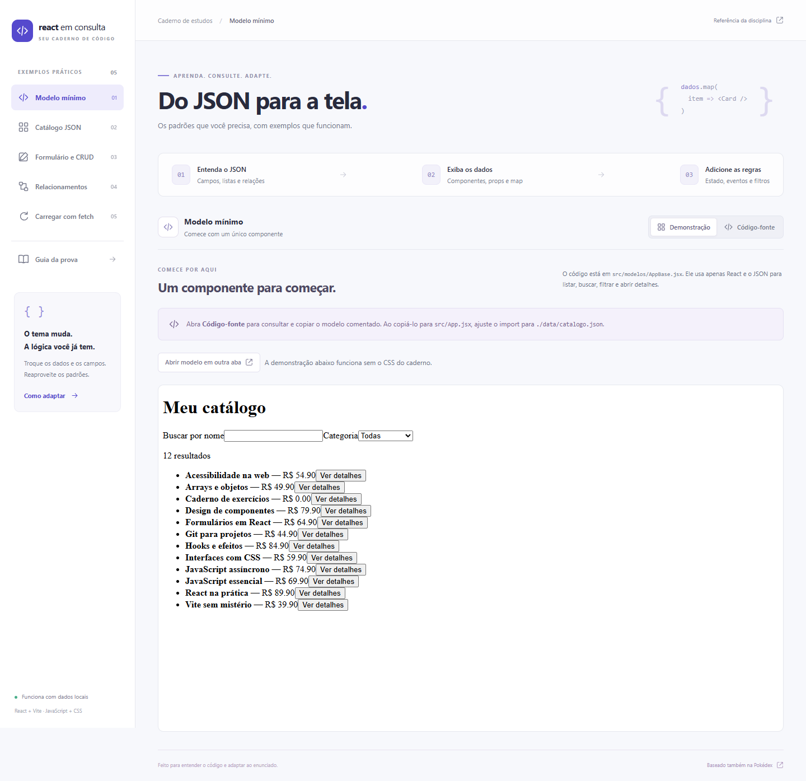

A página independente mostra o mesmo modelo com a aparência padrão do navegador:

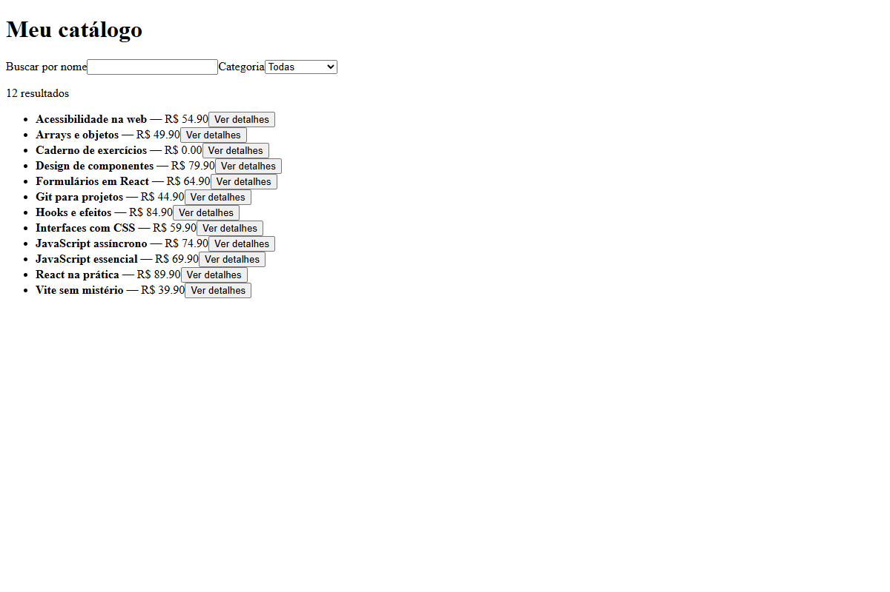

Para copiar para o projeto da prova:

1. Copie o conteúdo de `src/modelos/AppBase.jsx` para `src/App.jsx` do projeto da atividade.
2. Ajuste o import para `import dados from './data/catalogo.json';` ou para o nome real do arquivo.
3. Troque os campos do exemplo pelos campos do JSON recebido.
4. Confira se `src/main.jsx` importa e renderiza o `App.jsx` que você acabou de salvar.
5. Aplique CSS conforme o enunciado. A captura mostra o modelo sem os estilos do caderno.

O nome da função exportada pode continuar sendo `AppBase`, pois a importação é `default`. O importante é o caminho do arquivo que `main.jsx` importa.

Trecho central do modelo:

```jsx
// Dentro do componente: guarde as escolhas, não uma segunda cópia filtrada da lista.
const [busca, setBusca] = useState('');
const [categoria, setCategoria] = useState('');

const visiveis = dados.itens
  .filter((item) => {
    const porNome = item.nome.toLowerCase().includes(busca.trim().toLowerCase());
    const porCategoria = !categoria || String(item.categoriaId) === categoria;
    return porNome && porCategoria;
  })
  .sort((a, b) => a.nome.localeCompare(b.nome, 'pt-BR'));
```

Os trechos deste README destacam uma parte da lógica. Para copiar um componente completo, abra o arquivo vinculado e acompanhe seus imports.

<a id="exemplos"></a>

## 6. Exemplos explicados e suas telas

As imagens desta seção são **capturas reais do navegador**. O script que as produz está em [docs/capturar-telas.cjs](docs/capturar-telas.cjs).

### 6.1. Catálogo: importar, listar, ordenar e paginar

**Arquivos:** [Catalogo.jsx](src/examples/Catalogo.jsx), [catalogo.js](src/utils/catalogo.js), [catalogo.json](src/data/catalogo.json), [Paginacao.jsx](src/components/Paginacao.jsx).

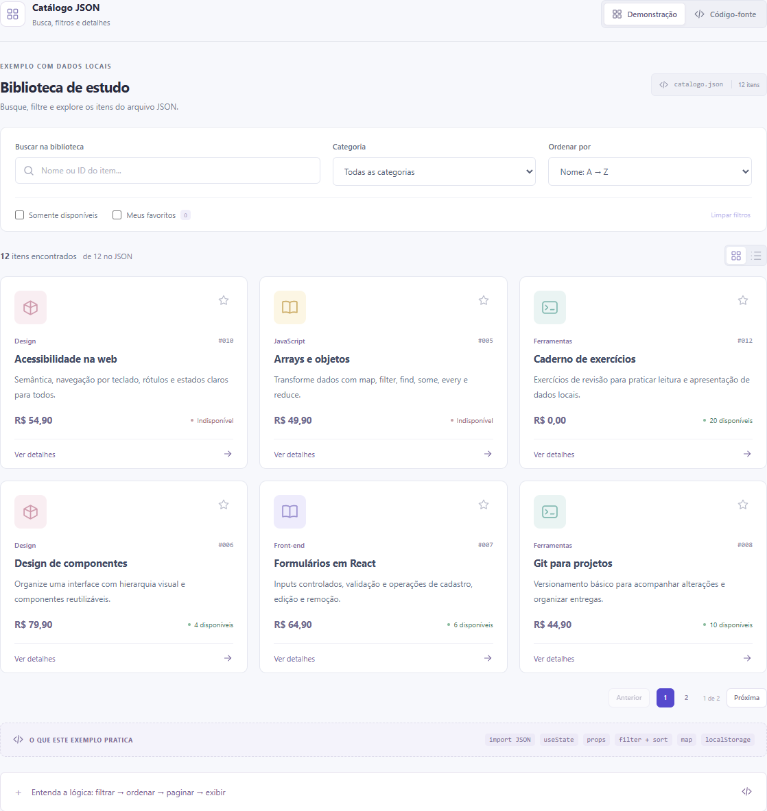

O componente importa os dados, guarda as escolhas do usuário e calcula a lista exibida. São seis itens por página; `map` monta um cartão para cada item dessa página.

```jsx
// Cada helper recebe dados e devolve um resultado sem alterar o JSON original.
const filtrados = filtrarItens(dados.itens, {
  busca, categoria, ordenacao,
  somenteDisponiveis, somenteFavoritos, favoritos,
});
const resultado = paginarItens(filtrados, pagina, 6);

// Dentro do JSX:
{resultado.itens.map((item) => (
  <article key={item.id}>
    <h4>{item.nome}</h4>
    <p>{formatarMoeda(item.preco)}</p>
  </article>
))}
```

`filtrarItens` usa `filter`, que cria outro array, e ordena esse array com `sort`. `paginarItens` usa `slice`, limita a página ao intervalo válido e devolve também o total de páginas.

### 6.2. Busca e filtros combinados

**Arquivos:** [CampoBusca.jsx](src/components/CampoBusca.jsx), [FiltroSelect.jsx](src/components/FiltroSelect.jsx), [Catalogo.jsx](src/examples/Catalogo.jsx) e [catalogo.js](src/utils/catalogo.js).

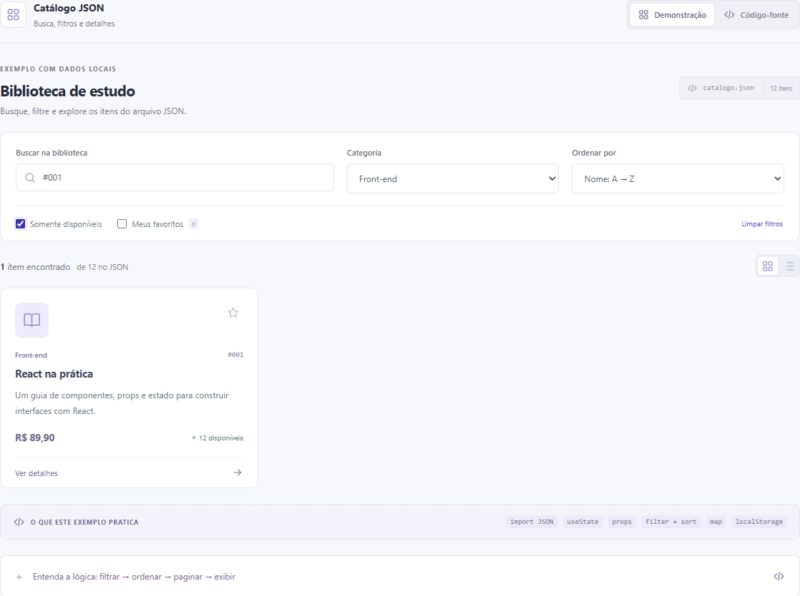

O catálogo aceita nomes sem diferenciar acentos e maiúsculas, e IDs numéricos exatos como `1`, `001` e `#001`. Os critérios são combinados com `&&`: o mesmo item precisa atender a todos os filtros ativos.

```jsx
// onChange entrega um novo texto; a função também volta à primeira página.
function mudarFiltro(setter, valor) {
  setter(valor);
  setPagina(1);
}

// Uso no JSX:
<CampoBusca
  valor={busca}
  aoMudar={(valor) => mudarFiltro(setBusca, valor)}
  placeholder="Nome ou ID do item..."
/>
```

A categoria **Dados** não tem itens de propósito. Ela permite verificar a mensagem e o botão de limpar filtros:

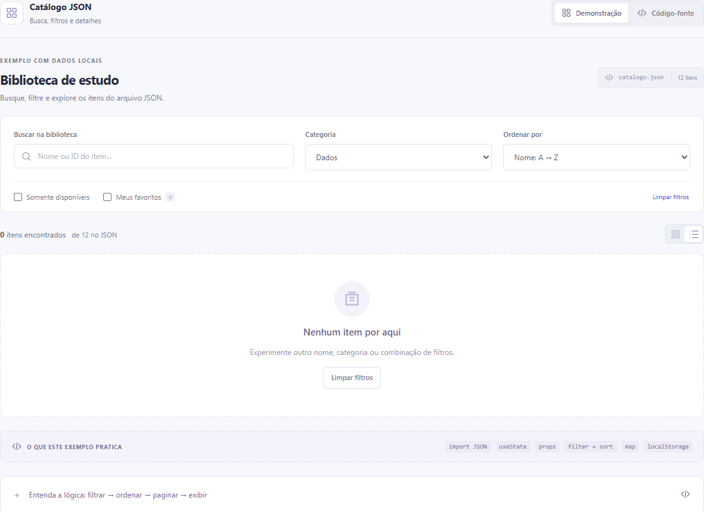

**Arquivo responsável pela mensagem:** [EstadoVazio.jsx](src/components/EstadoVazio.jsx).

### 6.3. Tabela: os mesmos dados em outra apresentação

**Código:** [Catalogo.jsx](src/examples/Catalogo.jsx), ramo `visualizacao === 'tabela'`.

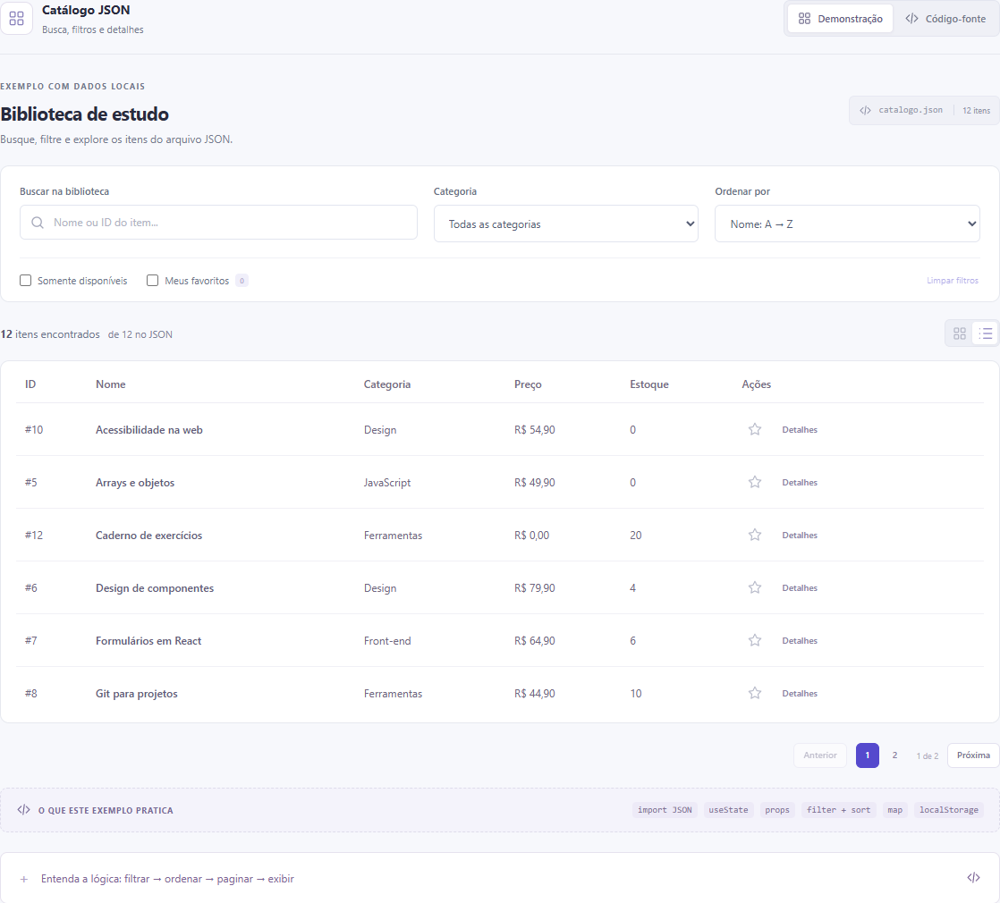

O botão muda apenas o estado `visualizacao`. Busca, filtros, ordem e paginação continuam utilizando o mesmo resultado. No lugar de `<article>`, o `map` gera linhas `<tr>` com células `<td>`.

### 6.4. Detalhes em uma janela modal

**Arquivos:** [Catalogo.jsx](src/examples/Catalogo.jsx) e [Modal.jsx](src/components/Modal.jsx).

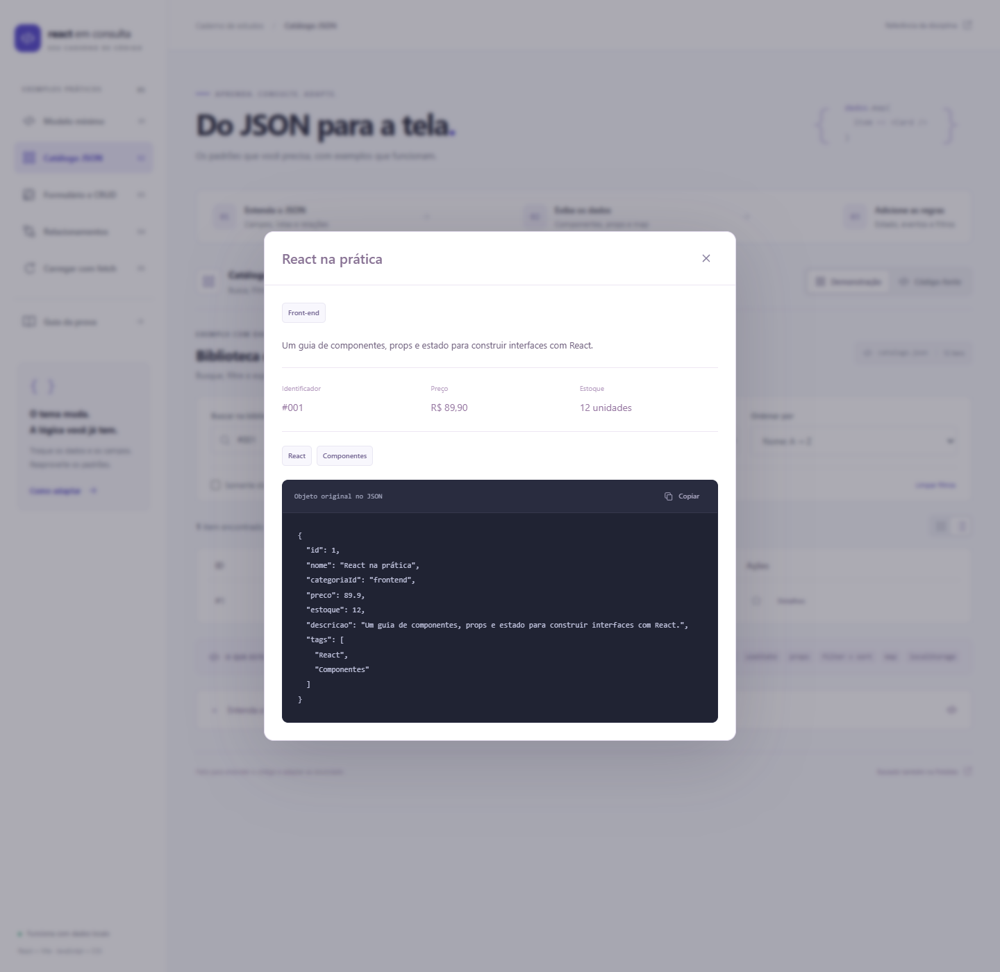

```jsx
const [selecionado, setSelecionado] = useState(null);

// O botão guarda o objeto clicado.
<button onClick={() => setSelecionado(item)}>Ver detalhes</button>

// A janela só é montada quando existe um objeto selecionado.
{selecionado && (
  <Modal titulo={selecionado.nome} aoFechar={() => setSelecionado(null)}>
    <p>{selecionado.descricao}</p>
  </Modal>
)}
```

O componente usa `<dialog>` e `showModal()`. O navegador gerencia a janela; o código trata Escape, clique no fundo, bloqueio de rolagem e devolução do foco ao fechar. `children` é o conteúdo colocado entre `<Modal>` e `</Modal>`.

### 6.5. Favoritos e localStorage

**Arquivos:** [Catalogo.jsx](src/examples/Catalogo.jsx) e [useLocalStorage.js](src/hooks/useLocalStorage.js).

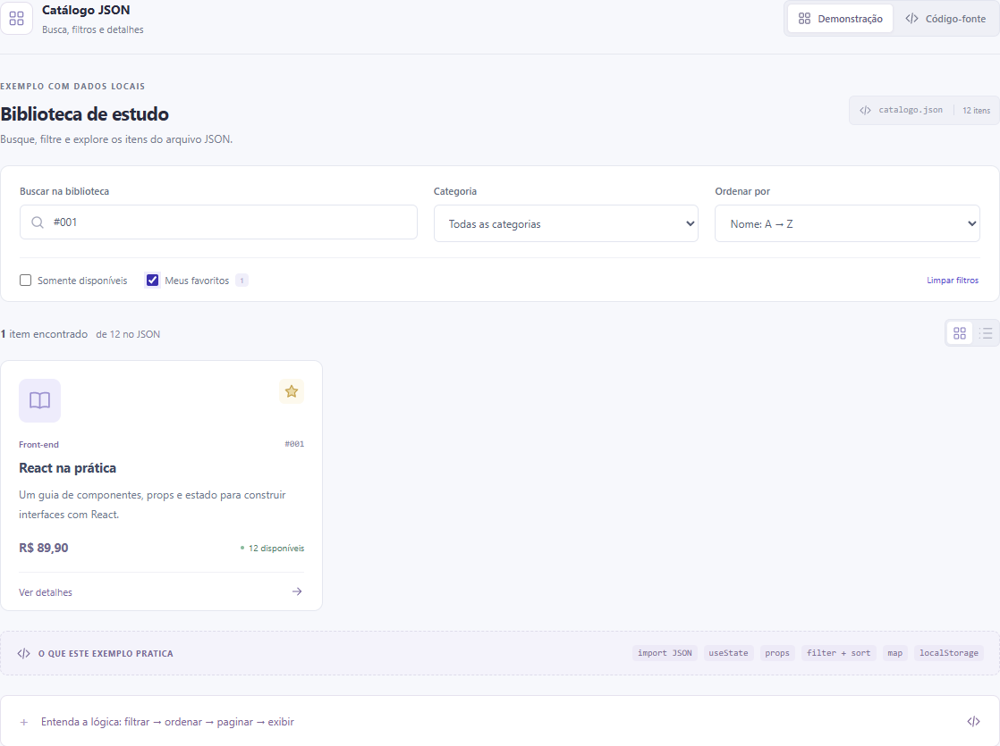

```jsx
const [favoritos, setFavoritos, aviso] = useLocalStorage(
  'react-consulta:favoritos', [],
);

// Atualização funcional: use a lista atual, mesmo em cliques consecutivos.
setFavoritos((atuais) => atuais.includes(id)
  ? atuais.filter((atual) => atual !== id)
  : [...atuais, id]);
```

Esse trecho ilustra IDs de um mesmo tipo. A implementação completa compara IDs com `String`, aceitando as duas representações. O hook lê o armazenamento ao iniciar e salva as mudanças com `useEffect`, usando `try/catch` para permitir o uso em memória quando o navegador bloquear o armazenamento.

### 6.6. Formulário: cadastrar, validar, editar e excluir

**Arquivos:** [Cadastro.jsx](src/examples/Cadastro.jsx), [catalogo.js](src/utils/catalogo.js) e [Modal.jsx](src/components/Modal.jsx).

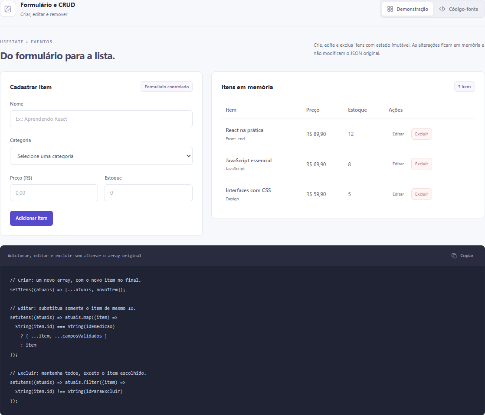

Um campo controlado tem `value` ligado ao estado e `onChange` que atualiza esse estado:

```jsx
function alterarCampo(event) {
  const { name, value } = event.target;
  setCampos((atuais) => ({ ...atuais, [name]: value }));
}

<input name="nome" value={campos.nome} onChange={alterarCampo} />
```

`[name]` escolhe a propriedade a atualizar; `...atuais` preserva os demais campos. No envio, `event.preventDefault()` evita o recarregamento da página.

| Operação | Como funciona no código |
| --- | --- |
| Validar | `validarItem(campos)` devolve um objeto de mensagens por campo. |
| Cadastrar | Converte os números e usa `[...atuais, novoItem]`. |
| Editar | Guarda o ID em edição e usa `map` para substituir apenas aquele item. |
| Cancelar edição | Limpa o formulário e o ID sem mudar a lista. |
| Excluir | Abre uma confirmação e usa `filter` para remover o ID escolhido. |

```jsx
// Criar: novo array, com o registro no final.
setItens((atuais) => [...atuais, novoItem]);

// Editar: novo objeto apenas para o registro selecionado.
setItens((atuais) => atuais.map((item) =>
  String(item.id) === String(idEmEdicao) ? { ...item, ...novosCampos } : item
));

// Excluir: outro array contendo todos os IDs restantes.
setItens((atuais) => atuais.filter((item) =>
  String(item.id) !== String(itemParaExcluir.id)
));
```

<details>
<summary>Ver validação, edição e confirmação de exclusão</summary>

**Validação:** quatro erros no envio vazio; o primeiro campo inválido recebe o foco.

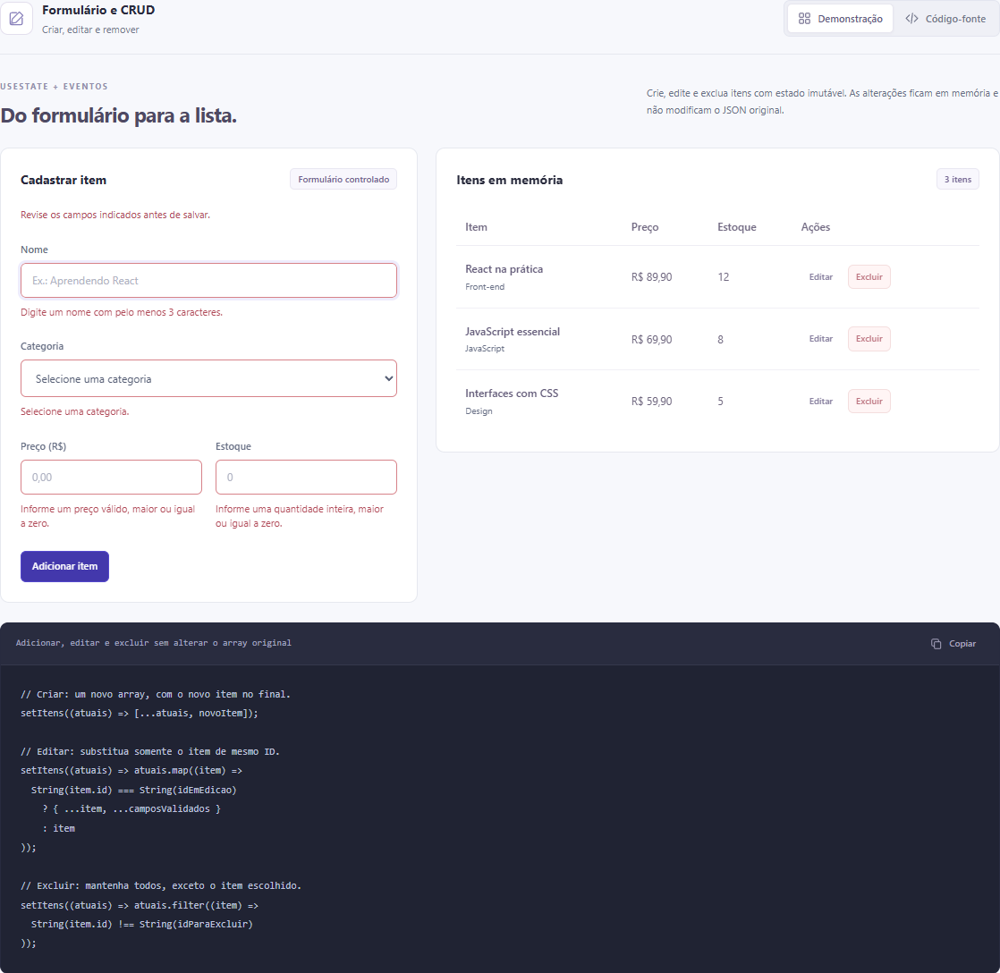

**Edição:** o botão Editar preenche os campos. Esta captura mostra um rascunho antes de salvar.

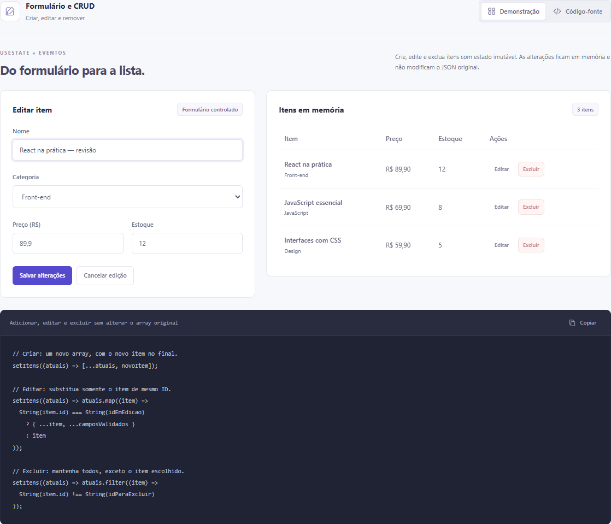

**Exclusão:** a confirmação identifica o item antes de removê-lo da cópia em memória.

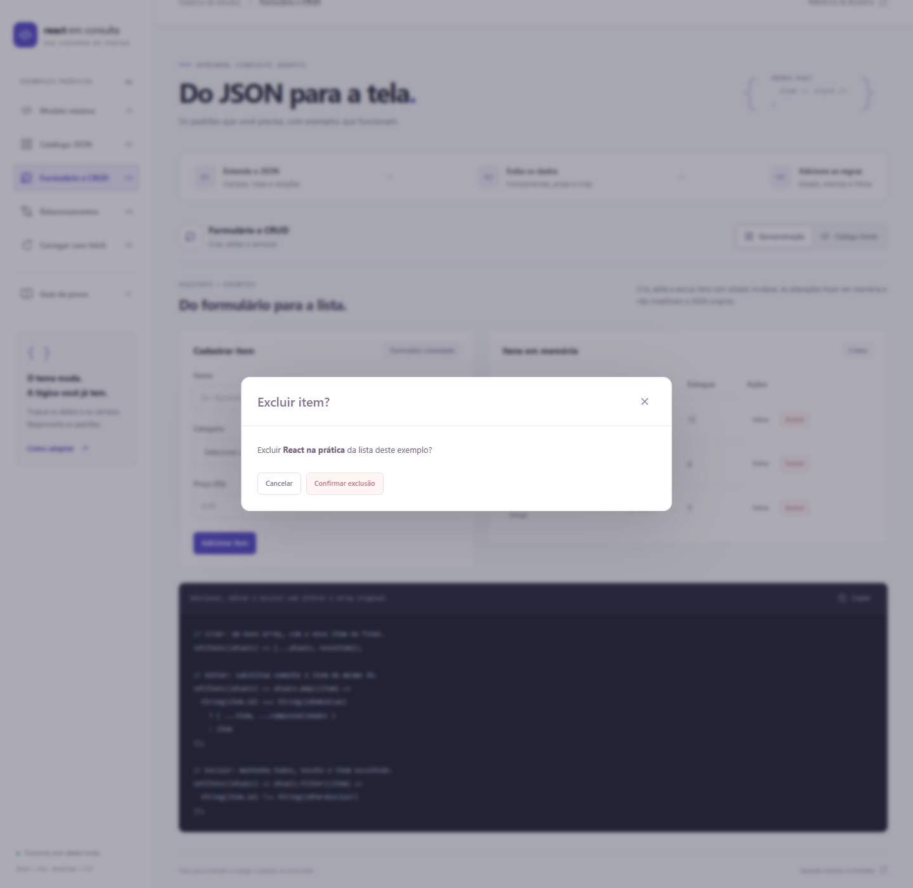

</details>

Preço e estoque zero são aceitos. Nome com menos de três caracteres, preço negativo e estoque fracionado são rejeitados. O arquivo JSON original não é regravado por essas operações.

### 6.7. Relacionamentos por IDs

**Arquivos:** [Relacionamentos.jsx](src/examples/Relacionamentos.jsx), [catalogo.js](src/utils/catalogo.js) e [catalogo.json](src/data/catalogo.json).

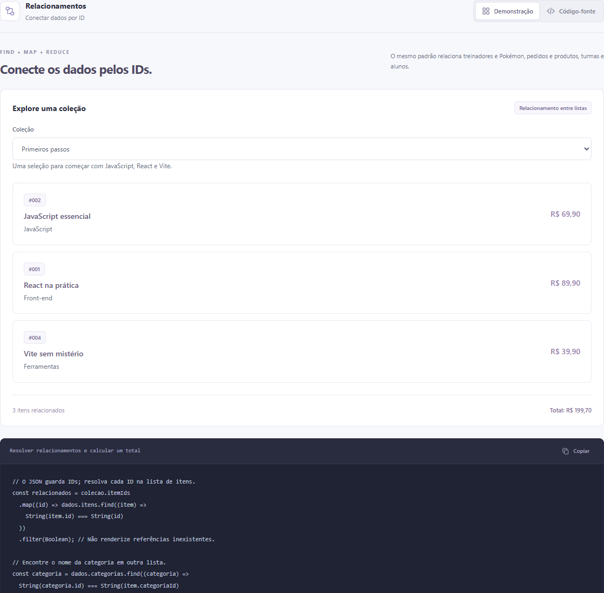

```jsx
// Ex.: colecao.itemIds = [2, 1, 4].
const relacionados = colecao.itemIds
  .map((id) => dados.itens.find((item) => String(item.id) === String(id)))
  .filter(Boolean);

const total = relacionados.reduce((soma, item) => soma + item.preco, 0);
```

`map` mantém a ordem dos IDs, `find` procura cada registro e `filter(Boolean)` remove as referências inexistentes. O valor inicial `0` permite que `reduce` some também uma coleção vazia.

O mesmo padrão conecta treinadores e Pokémon, pedidos e produtos ou turmas e alunos. Quando uma relação aceita IDs repetidos, a chave visual combina ID e posição.

<details>
<summary>Ver referência ausente e coleção vazia</summary>

**Referência ausente:** “Construindo interfaces” contém o ID `999`, que não existe na lista. Os demais registros continuam aparecendo.

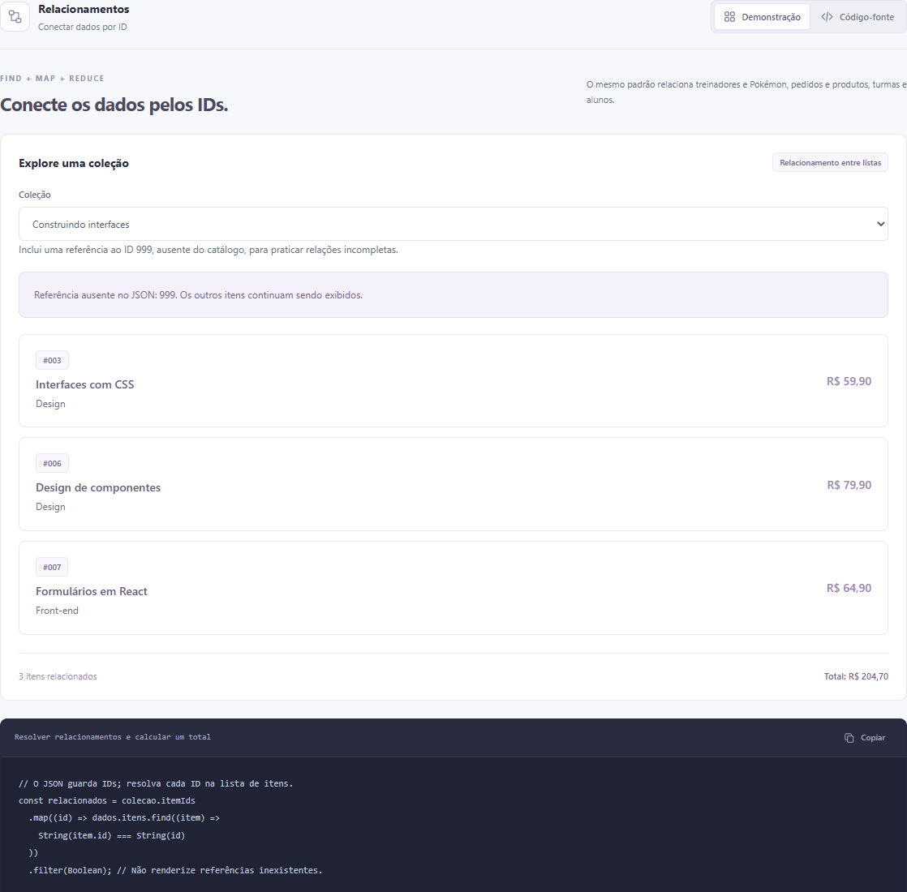

**Coleção vazia:** “Próxima leitura” tem `itemIds: []`, mensagem explicativa e total zero.

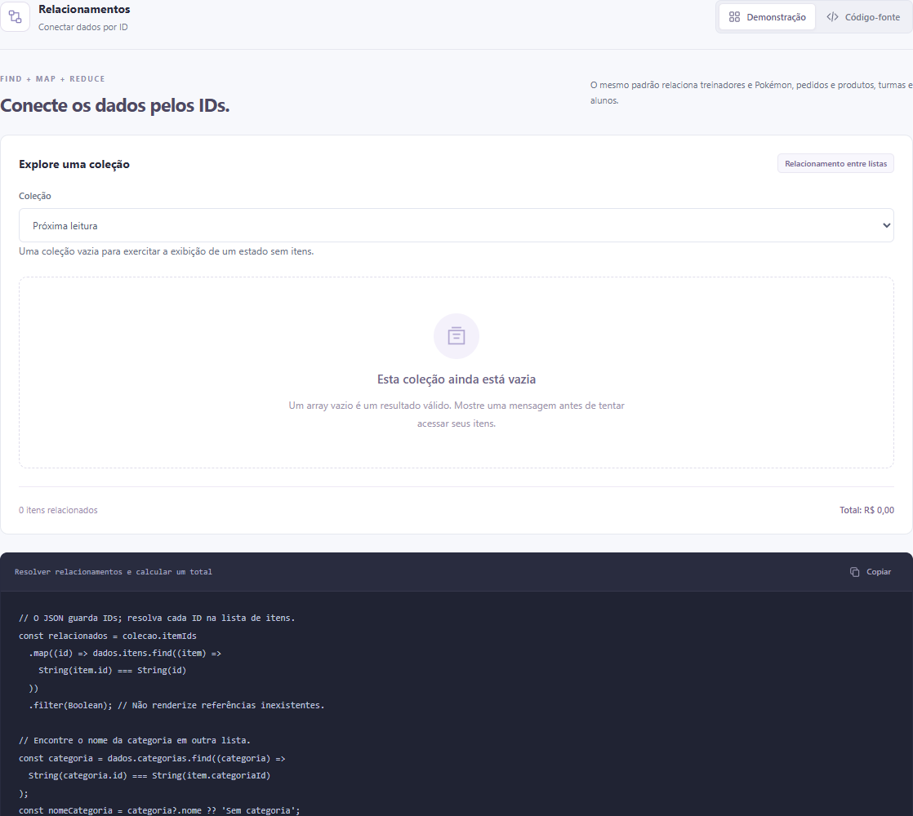

</details>

### 6.8. Carregar um JSON com fetch e useEffect

**Arquivos:** [Carregamento.jsx](src/examples/Carregamento.jsx) e [public/dados-exemplo.json](public/dados-exemplo.json).

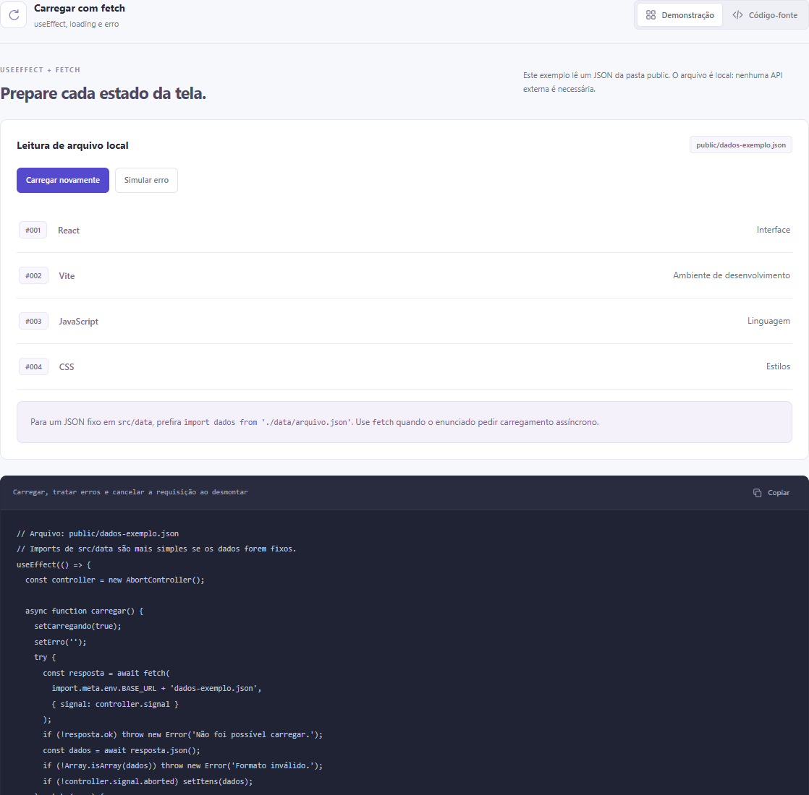

Use `import` quando os dados forem fixos em `src/data`. Este exemplo de `fetch` serve para estudar carregamento assíncrono a partir de uma URL local:

```jsx
// public/dados-exemplo.json é servido como dados-exemplo.json na base do site.
const resposta = await fetch(
  import.meta.env.BASE_URL + 'dados-exemplo.json',
  { signal: controller.signal },
);

if (!resposta.ok) throw new Error('Falha ao carregar.');
const recebidos = await resposta.json();
```

No componente completo:

1. O efeito cria um `AbortController` e inicia `carregando`.
2. A requisição valida HTTP, tipo de conteúdo e estrutura dos registros.
3. O sucesso atualiza `itens`; a falha atualiza `erro`.
4. `finally` encerra o carregamento se a requisição não foi cancelada.
5. O retorno do efeito chama `abort()` ao desmontar ou iniciar outra requisição.

<details>
<summary>Ver carregamento e erro com nova tentativa</summary>

**Carregamento:** indicador exibido enquanto uma requisição real aguarda a resposta.

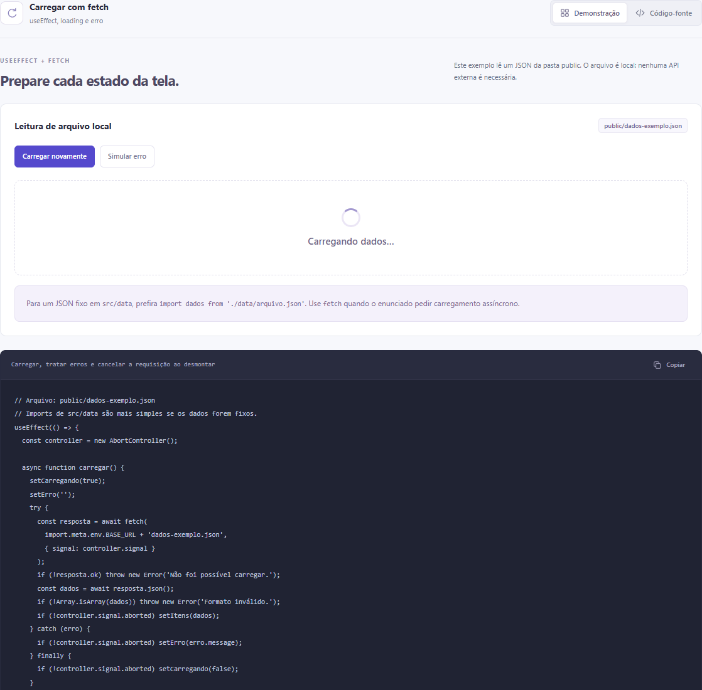

**Erro:** o botão Simular erro solicita um caminho inexistente. Tentar novamente volta para o JSON válido.

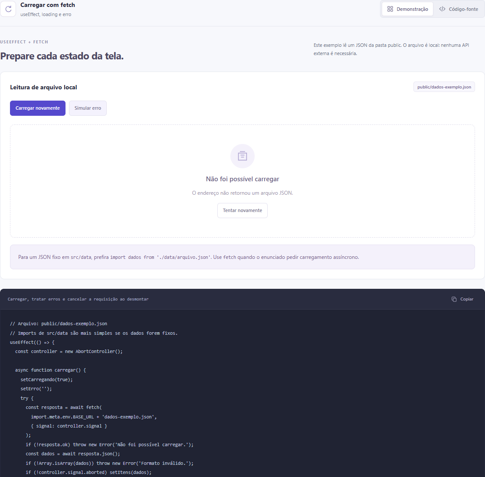

</details>

O Vite pode responder `index.html` para uma URL desconhecida. Por isso o exemplo completo também verifica o conteúdo, em vez de depender somente do status HTTP 200.

### 6.9. Código-fonte e guia dentro da interface

**Arquivos:** [App.jsx](src/App.jsx), [BlocoCodigo.jsx](src/components/BlocoCodigo.jsx) e [Guia.jsx](src/examples/Guia.jsx).

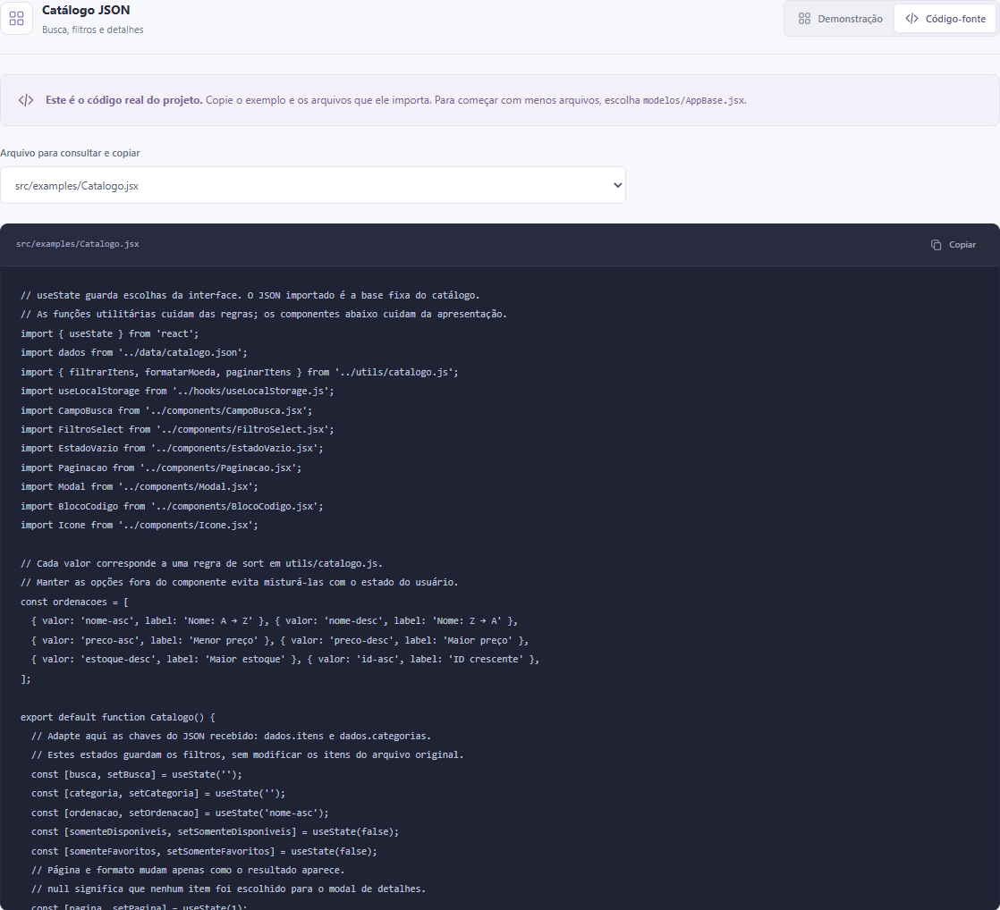

O visualizador lê os arquivos reais usando recursos do Vite, incluindo `?raw`. Os comentários adicionados aos arquivos também aparecem ao consultar o código. Copiar um exemplo completo exige acompanhar os arquivos que ele importa.

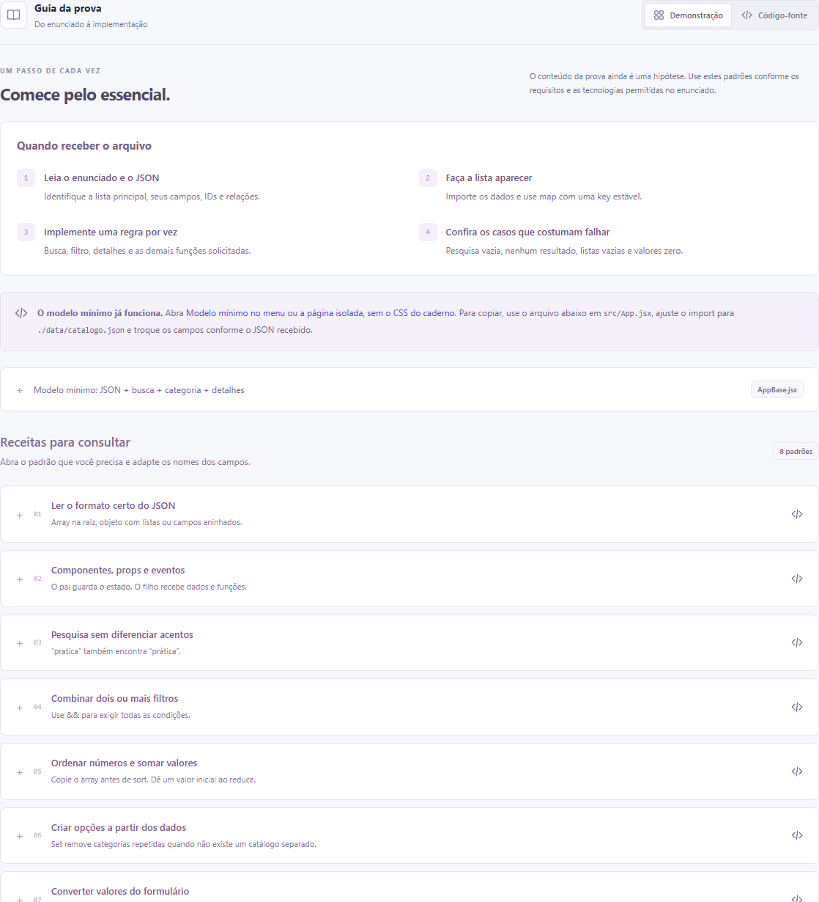

O guia contém receitas pequenas para leitura de JSON, props, eventos, normalização, filtros, totais e formulários. Os elementos nativos `details` e `summary` abrem as receitas sem exigir um estado React para cada uma.

Alternar entre Demonstração e Código-fonte preserva o estado do exemplo. Trocar para outra página desmonta o anterior; o CRUD em memória reinicia quando você retorna.

<a id="componentes"></a>

## 7. Componentes reutilizáveis e suas props

Os arquivos estão comentados por responsabilidade: **dados de entrada, estado, eventos, efeitos/limpeza e blocos de JSX**. Os comentários explicam a intenção e as decisões de cada parte.

| Código | O que aparece | Props ou contrato principal | Imagem |
| --- | --- | --- | --- |
| [CampoBusca.jsx](src/components/CampoBusca.jsx) | Label, ícone e campo de busca | `valor`, `aoMudar`, `label`, `placeholder` | [Busca](docs/imagens/02-filtros.png) |
| [FiltroSelect.jsx](src/components/FiltroSelect.jsx) | Label e lista de opções | `label`, `valor`, `aoMudar`, `opcoes: [{ valor, label }]` | [Filtros](docs/imagens/02-filtros.png) |
| [EstadoVazio.jsx](src/components/EstadoVazio.jsx) | Mensagem e ação opcional | `titulo`, `descricao`, `acao`, `aoAcao` | [Sem resultados](docs/imagens/05-sem-resultados.png) |
| [Paginacao.jsx](src/components/Paginacao.jsx) | Anterior, números e Próxima | `pagina`, `totalPaginas`, `aoMudar` | [Rodapé do catálogo](docs/imagens/01-catalogo.png) |
| [Modal.jsx](src/components/Modal.jsx) | Janela com título, conteúdo e fechar | `titulo`, `aoFechar`, `children` | [Detalhes](docs/imagens/04-detalhes.png) |
| [BlocoCodigo.jsx](src/components/BlocoCodigo.jsx) | Código e botão Copiar | `titulo`, `codigo`, `linguagem` | [Visualizador](docs/imagens/16-codigo.png) |
| [Icone.jsx](src/components/Icone.jsx) | Ícone SVG local | `nome`, `tamanho` e demais atributos SVG | [Ícones no catálogo](docs/imagens/01-catalogo.png) |

Exemplo de como reutilizar um componente:

```jsx
import { useState } from 'react';
import CampoBusca from './components/CampoBusca.jsx';

export default function MinhaBusca() {
  const [texto, setTexto] = useState('');

  return (
    <CampoBusca valor={texto} aoMudar={setTexto} label="Pesquisar produtos" />
  );
}
```

O componente filho não decide qual lista filtrar: ele avisa o pai quando o texto muda. Para copiar a aparência deste caderno, leve também as classes utilizadas em `styles.css`.

### Arquivos que não desenham uma tela sozinhos

| Código | Responsabilidade | Onde seu efeito é visível |
| --- | --- | --- |
| [useLocalStorage.js](src/hooks/useLocalStorage.js) | Ler/salvar estado no navegador e tratar falhas | [Favoritos após recarregar](docs/imagens/20-favoritos.png). |
| [catalogo.js](src/utils/catalogo.js) | Busca, filtros, ordem, paginação, moeda, relações e validação | [Filtros](docs/imagens/02-filtros.png), [validação](docs/imagens/07-validacao.png) e [relações](docs/imagens/10-relacionamentos.png). |
| [main.jsx](src/main.jsx) e [index.html](index.html) | Conectar a árvore React ao HTML | A aplicação inteira, mostrada nas capturas. |
| [vite.config.js](vite.config.js) e [package.json](package.json) | Configurar o ambiente e os comandos | Servidor/build; não geram um componente visual. |
| [catalogo.test.js](tests/catalogo.test.js) | Conferir regras automaticamente | Resultado no terminal de `npm.cmd test`. |

<a id="fundamentos"></a>

## 8. Métodos de array e fundamentos do React

### 8.1. Qual método usar?

| Você quer… | Método | Exemplo |
| --- | --- | --- |
| Transformar registros em JSX | `map` | `itens.map((item) => <p key={item.id}>{item.nome}</p>)` |
| Manter os registros que atendem a uma condição | `filter` | `itens.filter((item) => item.estoque > 0)` |
| Buscar o primeiro registro correspondente | `find` | `itens.find((item) => item.id === id)` |
| Saber se algum registro atende à condição | `some` | `itens.some((item) => item.id === id)` |
| Exigir que todas as condições sejam atendidas | `every` | `tiposSelecionados.every((tipo) => item.tipos.includes(tipo))` |
| Verificar a presença de um valor simples | `includes` | `favoritos.includes(id)` |
| Somar ou acumular valores | `reduce` | `itens.reduce((soma, item) => soma + item.preco, 0)` |
| Ordenar sem mudar o array original | cópia + `sort` | `[...itens].sort((a, b) => a.preco - b.preco)` |
| Selecionar um intervalo sem alterar o array | `slice` | `itens.slice(inicio, inicio + porPagina)` |
| Remover valores simples repetidos | `Set` | `[...new Set(itens.map((item) => item.categoria))]` |

`sort` altera o array sobre o qual é chamado; faça uma cópia, ou ordene o resultado de `filter`. `splice` e `slice` são diferentes: `splice` modifica o array.

### 8.2. O que vai no estado?

| Conceito | Uso neste projeto |
| --- | --- |
| `useState` | Texto da busca, categoria, página, item selecionado e campos do formulário. |
| Estado derivado | Resultado filtrado, total de registros, categoria encontrada e soma dos preços. |
| Props | Dados e funções passados do componente pai para o filho. |
| `onChange` | Atualizar um campo conforme o usuário digita ou seleciona. |
| `onClick` | Abrir detalhes, trocar página, marcar favorito ou iniciar edição. |
| `onSubmit` | Validar e processar o formulário. |
| `useEffect` | Sincronizar com algo externo: requisição, armazenamento ou evento do navegador. |
| Limpeza do efeito | Cancelar requisição, remover listener ou restaurar foco/rolagem. |
| `useRef` | Acessar um elemento para dar foco ou guardar um temporizador sem renderizar. |
| `useId` | Associar um label ao input sem repetir IDs em várias instâncias. |

`setItens((atuais) => ...)` é útil quando o novo valor depende do anterior. Não use `itens.push(...)` para atualizar o estado.

Para filtrar uma lista local, calcule `const filtrados = ...` durante a renderização. Não é necessário copiar o resultado para outro `useState` e sincronizá-lo com `useEffect`.

### 8.3. Filtro de vários tipos, como na Pokédex

Se cada item guarda tipos como objetos, por exemplo `tipos: [{ id: 1 }, { id: 2 }]`:

```jsx
const filtrados = itens.filter((item) =>
  tiposSelecionados.every((idSelecionado) =>
    (item.tipos ?? []).some((tipo) => String(tipo.id) === String(idSelecionado))
  )
);
```

`every` exige todos os tipos escolhidos. Sem seleção, todos os itens passam. Para aceitar qualquer tipo escolhido, use `some` na seleção e trate a seleção vazia explicitamente.

Mais exemplos estão no [guia completo](docs/GUIA-PROVA.md) e nas receitas da [interface](src/examples/Guia.jsx).

<a id="persistencia"></a>

## 9. Memória, JSON e persistência

| Informação | Onde fica | O que acontece ao recarregar |
| --- | --- | --- |
| Catálogo original | Arquivo `src/data/catalogo.json` | Continua igual. Filtros não o modificam. |
| Busca, categoria, página e modal | Estado React | Voltam ao estado inicial. |
| Registros criados/editados no CRUD | Cópia em memória dos três primeiros itens | Voltam aos três registros iniciais. |
| Favoritos | `localStorage`, chave `react-consulta:favoritos` | São recuperados, se o navegador permitir. |
| Dados do fetch | Estado após ler `public/dados-exemplo.json` | São carregados novamente ao abrir o exemplo. |

Este projeto não grava alterações no JSON em disco e não possui backend. O hook de armazenamento é opcional; use-o quando a atividade pedir persistência no navegador.

Para utilizar favoritos apenas em memória, troque o hook por `const [favoritos, setFavoritos] = useState([])` e remova a apresentação do aviso de armazenamento.

`localStorage` é separado por origem: mudar de host ou porta pode mostrar outro conjunto de favoritos. O hook verifica se o valor recuperado é um array, mas não valida cada elemento desse array.

<a id="css"></a>

## 10. CSS e versão para celular

[styles.css](src/styles.css) está dividido por comentários: base, acessibilidade, estrutura, navegação, filtros, cartões, botões, tabela, formulário, relações, fetch, código, guia, modal e responsividade.

- `Grid` organiza menu/conteúdo, filtros e cartões.
- `Flexbox` alinha botões e organiza blocos em sequência.
- `minmax(0, 1fr)` e `min-width: 0` ajudam os elementos a encolher sem alargar a página.
- `overflow-x: auto` mantém a rolagem de tabelas e código dentro de seus contêineres.
- Media queries alteram colunas e navegação conforme a largura da tela.
- `:focus-visible`, labels e atributos ARIA ajudam a usar os controles pelo teclado e com leitores de tela.

<details>
<summary>Ver a interface em um celular de 390 px</summary>

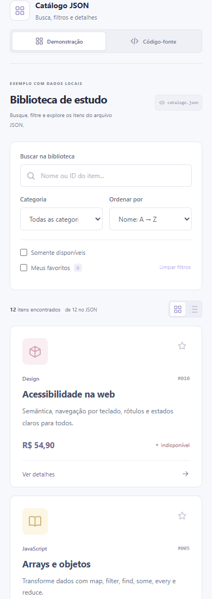

</details>

<a id="erros"></a>

## 11. Erros comuns e como corrigir

| Sintoma | O que conferir |
| --- | --- |
| `npm.ps1` bloqueado | Use `npm.cmd` no PowerShell. |
| `ENOENT` citando `package.json` | Confira a pasta atual com `Get-Location` e entre na pasta do projeto. |
| `Missing script: lint` ou outro script | Veja `npm.cmd run`; este projeto não tem script de lint. |
| Porta ocupada | Use a URL realmente exibida ou escolha `--port 5174`. |
| Tela vazia | Confira o console e o terminal; revise imports e se `main.jsx` renderiza o componente esperado. |
| `dados.map is not a function` | O JSON pode ser objeto; procure a lista em `dados.itens`, `dados.produtos` etc. |
| `Cannot read properties of undefined` | Confira o nome do campo, o resultado de `find` e listas vazias; use `?.` quando o campo for opcional. |
| Objeto não pode ser filho do React | Exiba `item.fabricante.nome`, não o objeto `item.fabricante` inteiro. |
| Aviso de `key` na lista | Use uma chave estável, normalmente `item.id`; uma relação com IDs repetidos exige distinguir cada ocorrência. |
| Filtro por ID não encontra registro | Compare tipos compatíveis; valores de `select` são texto. |
| O número `0` aparece antes de uma lista | Use `itens.length > 0 && ...`, em vez de `itens.length && ...`. |
| Preço vazio virou zero | `Number('')` é `0`; valide o texto vazio antes de converter. |
| Ordenação muda o JSON ou o estado | Copie o array antes de chamar `sort`. |
| O botão executa ao renderizar | Use `onClick={() => selecionar(item)}`, não `onClick={selecionar(item)}`. |
| O formulário recarrega a página | Chame `event.preventDefault()` no handler de envio. |
| `fetch` recebe HTML | Confira a URL, a pasta `public`, o tipo de conteúdo e a base do projeto. |
| `preview` mostra uma versão antiga | Rode o build novamente: o preview lê `dist/`. |
| Abrir `index.html` com duplo clique não funciona | Inicie `dev` ou `preview` e use a URL HTTP informada. |

<a id="validacao"></a>

## 12. Validação e reprodução das imagens

### Conferir a implementação

```powershell
npm.cmd test
npm.cmd run build
```

Os 11 testes de dados verificam busca, acentos, ID exato, filtros combinados, ordenação sem mutação, paginação, validação e relacionamentos. O teste inclui categoria com ID zero e referências repetidas.

A interface também passou por 53 cenários no Edge com Playwright: catálogo, favoritos, CRUD, modal, relacionamentos, fetch, cópia de código, recuperação de armazenamento inválido e as cinco seções nas larguras de 320, 390, 768 e 1440 px. As imagens desta documentação foram produzidas em uma captura adicional.

### Atualizar as capturas no futuro

As 21 imagens estão versionáveis em [docs/imagens/](docs/imagens/). O script [capturar-telas.cjs](docs/capturar-telas.cjs) abre a aplicação, reproduz os estados e salva as capturas; para o modelo mínimo, usa a entrada permanente [modelo.html](modelo.html), sem importar o CSS do caderno.

**Essa etapa é opcional e serve à documentação.** Playwright não é dependência da aplicação.

Os passos abaixo usam **PowerShell no Windows e Microsoft Edge instalado**.

1. Mantenha `npm.cmd run dev` aberto em um terminal.
2. Em outro terminal, disponibilize o Playwright fora das dependências principais:

```powershell
# Pasta ignorada pelo Git; não altera o package.json da aplicação.
New-Item -ItemType Directory -Force .qa/ferramentas | Out-Null
npm.cmd install --prefix .qa/ferramentas --no-save --package-lock=false playwright

# Informa ao script onde está o módulo instalado para documentação.
$env:PLAYWRIGHT_MODULE = (Resolve-Path '.qa/ferramentas/node_modules/playwright').Path

# Gera novamente as 21 imagens a partir do aplicativo local.
node docs/capturar-telas.cjs
```

O script usa Edge no Windows por padrão. Se necessário, configure `EDGE_PATH` para o executável de um navegador Chromium compatível e `CAPTURE_URL` para outra URL local. O script utiliza um contexto novo de navegador, sem alterar seus favoritos pessoais.

### Referências de consulta

- [Guia da prova, com snippets adicionais](docs/GUIA-PROVA.md).
- [Arquivos estudados nos dois repositórios fornecidos](docs/REFERENCIAS.md).
- [Começar um projeto com Vite](https://vite.dev/guide/).
- [Opções da linha de comando do Vite](https://vite.dev/guide/cli).
- [Importar JSON no Vite](https://vite.dev/guide/features.html#json).
- [Build e preview](https://vite.dev/guide/static-deploy.html).
- [Listas no React](https://react.dev/learn/rendering-lists).
- [Atualizar arrays no estado](https://react.dev/learn/updating-arrays-in-state).

<a id="checklist"></a>

## 13. Checklist antes de entregar

- [ ] O JSON original foi preservado e os campos foram conferidos.
- [ ] A lista inicial aparece com as informações pedidas.
- [ ] Cada elemento gerado com `map` possui uma chave adequada.
- [ ] Busca e filtros funcionam separados e combinados.
- [ ] Busca vazia, nenhum resultado, arrays vazios e valores zero foram testados.
- [ ] Detalhes e relacionamentos exibem os registros corretos.
- [ ] Formulários validam os campos e não recarregam a página.
- [ ] A interface funciona nas larguras solicitadas e com teclado.
- [ ] Console e terminal não apresentam erros da aplicação.
- [ ] `npm.cmd run build` termina com sucesso.
- [ ] O README informa como instalar e executar o projeto.
- [ ] A entrega inclui fonte, configuração, `package.json`, lockfile e dados exigidos.
- [ ] Os requisitos de autoria, identificação e entrega do enunciado foram cumpridos.
